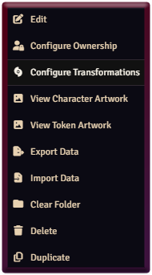

# Chef’s Transformations

Add animated transformations and saved forms to your actors in **D&D5e** and **PF2e**. Includes **Fire, Lightning Yellow, Smoke, and Water**.

## Getting started

1. Enable the module in your world.
2. As GM, right-click an actor in the Actors directory and select **Configure Transformations**.

   

3. On the **Animation** tab, choose an animation, optional audio, and **Sustain Aura**. Use **Set as Campaign Default** to apply these settings as the campaign default.
4. On **Transformation Presets**, drag in the actor you want to transform into, configure its options, and save.
5. Use the token’s **Transformations** button to choose a saved form or **Revert to original form**.

Each form preset captures the animation, audio, and sustain settings selected when you create it. To change them, remove and recreate that preset with your new settings.

**Sustain Aura** keeps the aura and audio playing until you revert. Otherwise, they play once and fade out.

## License

Bundled animations use the [Chef's Transformations Asset License](ASSET-LICENSE.md). You may use them in Foundry games and gameplay recordings, but may not redistribute or resell them as standalone assets or asset packs. This license does not cover the module's code.

## Third-party software

Includes JSZip and pako. Their license notices are in third-party/.
